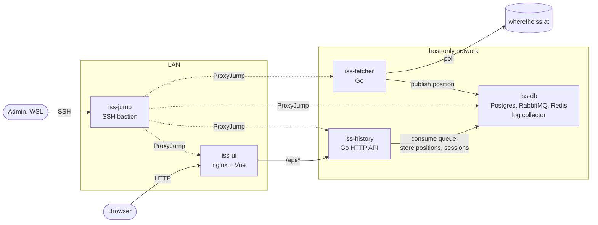

# ISS Position Tracker

Tracks the International Space Station in real time, stores its history and predicts when it will pass over a point you pick on the map. The system runs as five Vagrant/VirtualBox VMs (Ubuntu 22.04): one SSH bastion and four application VMs, each running its own Docker Compose project.

## Features

- Live ISS position, altitude, velocity and visibility, refreshed every 15 s, with trend charts and a track on a Leaflet map.
- Passes over your location: the last recorded pass (from stored history) and the next predicted pass (an orbit model fitted to the stored history, up to 48 h ahead).
- Theme and location are remembered per browser session.
- Interchangeable backends: the message queue (RabbitMQ, Postgres table + `LISTEN/NOTIFY`, or pgmq) and the session store (Redis, Postgres table, or hstore) are selected in `.env`.
- Hardened access: a single SSH entry point (bastion with tunnel-only user and fail2ban), per-VM admin user, no direct SSH from the LAN.
- Centralised logs: the database VM pulls container and SSH logs from every VM over SSH on a cron schedule.

## Architecture



| VM | Containers | Role |
|---|---|---|
| `iss-jump` | none | SSH bastion, the only SSH entry point; bridged to the LAN; fail2ban |
| `iss-db` | postgres (with pgmq, pg_cron), redis, rabbitmq | shared infrastructure and log collector |
| `iss-fetcher` | fetcher (Go) | polls wheretheiss.at and publishes positions to the queue |
| `iss-history` | history (Go) | consumes the queue into Postgres; serves `/history`, `/settings`, `/passes` |
| `iss-ui` | ui (Vue 3 + Vite, served by nginx) | web UI; nginx proxies `/api/*` to history; bridged to the LAN |

## Requirements

- Windows 10/11 host with at least 8 GB of free RAM (the VMs take 5.5 GB) and VirtualBox 7.
- Vagrant for Windows (`vagrant.exe`).
- WSL 2 with the default Ubuntu distribution (the SSH client and helper scripts run there).
- Internet access from the VMs (Docker images, the ISS API, map tiles).
- Optional, for UI development: Node.js 20+.

## Quick start

```bash
cp .env.example .env
```

Set real passwords in `.env` (every `change_me` value), then create and provision all VMs:

```bash
vagrant.exe up
```

The first run takes 15-25 minutes. When it finishes:

- UI: `http://<UI_IP>:<UI_PORT>` from the host (default `http://192.168.56.13`), or the LAN address of `iss-ui` from any device on the network.
- SSH from WSL: `ssh iss-db`, `ssh iss-history`, ... (routed through the bastion automatically).

The next-pass prediction needs at least an hour of stored positions. To have it immediately, backfill the last 24 hours from the public API (run in WSL):

```bash
./scripts/backfill-positions.sh 24 60
```

## Configuration

`.env` in the repository root is the single source of truth; `.env.example` lists every key. It is never copied into the VMs as is: for each VM, Vagrant writes an env file with only the keys that VM's `deploy/<vm>/compose.yaml` references.

Backend modes:

| Key | Values | Notes |
|---|---|---|
| `QUEUE_BACKEND` | `rabbitmq`, `postgres`, `pgmq` | `rabbitmq` is auto-ack and may lose messages; the Postgres modes do not |
| `SESSION_BACKEND` | `redis`, `postgres`, `hstore` | `hstore` uses an unlogged table expired by pg_cron |

Switching a mode after the VMs exist:

```bash
vagrant.exe provision iss-db --provision-with upload,deploy,postgres-roles
```

```bash
vagrant.exe provision iss-history iss-fetcher --provision-with upload,deploy
```

Messages in flight in the old queue and sessions in the old store are not migrated.

## Operations

All shell scripts run in WSL from the repository root.

| Task | Command |
|---|---|
| Redeploy one service after a code or `.env` change | `vagrant.exe provision iss-history --provision-with upload,deploy` |
| Read collected logs | `./scripts/logs.sh <db\|history\|fetcher\|ui\|jump\|collector> [-f] [-s svc] [-l error\|warn] [-g regex] [-n N] [-d YYYY-MM-DD]` |
| Container and VM resource usage | `./scripts/docker-stats.sh` |
| Bastion shell (the `jump` user has none) | `vagrant.exe ssh iss-jump` |
| Recovery shell on any VM | `vagrant.exe ssh <vm>` |
| Stop / start everything | `vagrant.exe halt` / `vagrant.exe up` |
| Remove everything | `vagrant.exe destroy -f` |

## Demo walkthrough

1. Open the UI: the status turns green and the ISS marker moves every 15 s; charts and the history table fill in.
2. Click anywhere on the map: the last recorded pass and the next predicted pass appear, with countdowns and the pass tracks drawn on the map. Change the radius to see the result update.
3. Switch to dark mode and reload the page: the theme and location are restored from the session store.
4. Show the security model from WSL: `ssh iss-db` works through the bastion, while `ssh iss-jump` gives no shell and direct SSH to the app VMs from the LAN is refused.
5. Show centralised logs: `./scripts/logs.sh history -n 20` and `./scripts/logs.sh jump -g sshd`.
6. Switch `QUEUE_BACKEND` to `pgmq` and `SESSION_BACKEND` to `hstore`, run the two provision commands above and show that data keeps flowing.

## Repository layout

```
.
├── Vagrantfile              VM list; everything else is in vagrant/
├── vagrant/                 Vagrant helpers: env parsing, SSH access, app and logging provisioners
├── deploy/<vm>/compose.yaml Compose project per VM (iss-<vm> → deploy/<vm>)
├── services/
│   ├── fetcher/             Go: ISS API poller and queue publisher
│   ├── history/             Go: queue consumer, HTTP API, orbit model
│   ├── postgres/            Postgres 16 image with pg_cron and pgmq
│   └── ui/                  Vue 3 + Vite UI and nginx config
└── scripts/
    ├── host/                Run from Vagrant on the host (WSL key and SSH config)
    ├── provision/           Run inside VMs by Vagrant provisioners
    └── *.sh                 Operator tools (logs, stats, backfill)
```

## API

Served by `iss-history`, exposed by the UI under `/api`.

| Endpoint | Description |
|---|---|
| `GET /history` | Latest positions, newest first (`HISTORY_RESULT_LIMIT`) |
| `GET /settings` | Theme and saved location for the session cookie |
| `POST /settings` | Body `{"theme": "dark"}` and/or `{"location": {"latitude", "longitude", "radius_km"}}` |
| `GET /passes?lat=&lon=&radius_km=` | Last recorded and next predicted pass; radius 100-3000 km |

## Development

UI dev server (proxies `/api` to `HISTORY_IP:HISTORY_PORT` from `.env`, so the VMs must be running):

```bash
cd services/ui && npm ci && npm run dev
```

Checks used in this repository (Docker on the host):

```bash
docker run --rm -v "$PWD/services/history:/src" -w /src golang:1.23-alpine sh -c "gofmt -l . && go vet ./... && go build -o /dev/null ."
```

```bash
docker run --rm -v "$PWD/scripts:/s:ro" koalaman/shellcheck:stable /s/*.sh /s/host/*.sh /s/provision/*.sh
```

```bash
docker compose -f deploy/history/compose.yaml --env-file .vagrant/iss-config/iss-history/iss.env config --quiet
```

## Troubleshooting

- `ssh iss-db` fails from WSL: `vagrant.exe reload iss-jump iss-db` rewrites `~/.ssh/iss_tracker/*.conf` and the `Include` line in `~/.ssh/config`.
- A VM got stuck or misconfigured: `vagrant.exe ssh <vm>` still works through Vagrant's NAT channel; re-run its provisioners with `vagrant.exe provision <vm>`.
- Next pass shows "model error": fewer than 20 positions over an hour are stored; wait or run the backfill script.
- No map tiles: the browser needs internet access to `tile.openstreetmap.org`.
