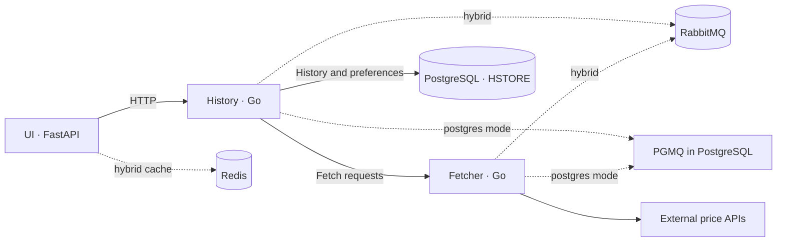

# Data Monitor

A web application for collecting and exploring cryptocurrency price history. Fetcher reads prices from public APIs, History periodically stores them in PostgreSQL, and the web interface displays current values and historical data.

> An educational project with separate services, message queues, Docker Compose for local development, and Vagrant for a multi-VM deployment.

## Features

- Fetch prices from configurable HTTP APIs (BTC and ETH via Coinbase by default).
- Store timestamped price history in PostgreSQL.
- Browse current prices and history in a web interface with charts and user preferences.
- Choose between RabbitMQ + Redis (`hybrid`) or PGMQ + HSTORE in PostgreSQL (`postgres`).
- Run locally with Docker Compose or deploy five VMs with Vagrant.

## Architecture



In `hybrid` mode, RabbitMQ carries requests between History and Fetcher, while Redis caches UI preferences. PostgreSQL stores history and preferences. In `postgres` mode, PGMQ in PostgreSQL provides the queue and HSTORE stores preferences; the applications do not connect to RabbitMQ or Redis.

## Deploy to GCP

From the repository root, after the one-time Registry/IAP setup and local
authentication:

```bash
make setup       # once per machine: local Python environment and Ansible collections
make deploy      # validate/build a release, start existing VMs, deploy all services
make deploy-ui   # update UI only, without system preparation
```

Commit and push changes in `DataFetcher/` before deploying. Releases are saved in
`.deploy/releases/` by the most recent application commit; repeated deployments
reuse that manifest and its immutable image digests. Terraform is never applied
by these commands. Bootstrap instructions are in
[gcp-terra/bootstrap/README.md](gcp-terra/bootstrap/README.md). For Ansible,
authenticate with `gcloud auth login` and `gcloud auth application-default login`,
then run `make setup`. SSH access also requires the configured key and trusted host keys.

### GCP configuration and shared deployment roles

`config.json` is the source for service addresses, host ports (`ports`) and the
application checkout directory (`deployment.app_dir`). Bastion's SSH port stays
in `compute.instances.bastion.startup.ssh_port`; firewall `port_keys` refers to it
as `bastion_ssh`. Other named firewall ports refer directly to `ports` keys.
Literal `ports` remain available for additional firewall rules. Set ports in the
shared configuration rather than overriding individual Ansible role variables.
Changing an SSH port also requires an explicit SSH configuration migration.

The service environment in Secret Manager retains credentials and application
settings. On GCP, Ansible replaces only the RabbitMQ/Redis URL host and port with
configured endpoints, preserving credentials, scheme, database/vhost and query.
The transformation happens in private memory before writing the root-owned
`0600` env file. Each enabled hybrid service must have exactly one supported URL
assignment. UI's History URL always comes from the shared configuration.
Compose/Vagrant development settings remain independent.

`http_service` shares the Fetcher/History deployment sequence; UI retains its
HTTPS lifecycle and PostgreSQL retains separate render/stop/start steps.
`release_manifest` validates both cached releases and VM deployment inputs.
Release validation/build completes before `start.yaml` powers existing VMs;
explicit rollback manifests may reference an older application commit.

Terraform resource selection stays inside its modules. Monitoring's services,
IAM, uptime, alerts and dashboard are separated into files within the same module,
without changing resource addresses. Backup settings and dependency version
ranges are unchanged by this refactor.

Terraform requires CLI 1.9 or newer (below 2.0); the Google provider remains pinned
to 6.8.0 for compatibility with the adopted Cloud SQL instance. Root files separate
version/backend requirements (`versions.tf`), provider configuration (`providers.tf`),
JSON loading (`locals.tf`) and module wiring (`main.tf`). To select another pair
of configurations, pass `-var='config_file=/absolute/path/config.json'` and
`-var='monitoring_file=/absolute/path/monitoring.json'`. Relative paths are resolved
from `gcp-terra`, and defaults still use the repository's JSON files. These flags
affect Terraform only; Ansible must use the corresponding configuration separately.

Modules validate VM names/IPs, subnet/region placement, disk sizes, firewall rules
and Cloud SQL peering/backup consistency before resource changes. VM resources,
Secret Manager secrets and the image repository have `prevent_destroy`, alongside
the existing SQL/PSA protection. A VM replacement or removing the postgres VM by
switching backend mode therefore requires reviewing and deliberately changing
the guard after preserving its data. This is a Terraform planning guard, not a
backup or protection against deletion through the GCP console; removing the
resource block also removes its guard. Resource addresses remain unchanged.

Local checks: `terraform -chdir=gcp-terra fmt -check -recursive` and
`terraform -chdir=gcp-terra validate`. Review an authenticated plan before apply;
local validation alone does not prove that the live infrastructure has no drift.

Review Cloud SQL plans while the existing instance is started (`ALWAYS`, with
startup completed). With the pinned provider, a stopped instance can make the existing `history` database appear
absent in a refreshed plan. Start the instance, wait for it to become runnable,
and generate a fresh plan before considering database creation. Terraform's
desired activation policy is `ALWAYS`; an intentional operational stop (`NEVER`)
will therefore differ from that desired state. Stopping resources does not
require destroying them or removing their Terraform configuration.
The Admin API's `RUNNABLE` state also includes instances stopped by their owner;
verify the activation policy and completed operation rather than this field alone
([API state definitions](https://docs.cloud.google.com/sql/docs/postgres/admin-api/rest/v1beta4/instances#SqlInstanceState)).

## Quick start with Docker Compose

You need Docker with Docker Compose and network access to pull images and call the price APIs.

```powershell
cd DataFetcher
Copy-Item .env.example .env
```

Edit `.env`, set your own passwords, and choose `APP_BACKEND=hybrid` or `APP_BACKEND=postgres`. Then start the services:

```sh
docker compose config
docker compose up --build -d
docker compose ps
```

Open the web UI at [http://localhost:8000](http://localhost:8000). Follow service logs with:

```sh
docker compose logs -f ui history fetcher postgres
```

Stop the services while keeping their data with `docker compose down`. The command `docker compose down -v` also deletes the PostgreSQL, Redis, and RabbitMQ volumes.

## Deploy with Vagrant

You need VirtualBox, Vagrant, and a network adapter whose name is set as `BRIDGE` in `Vagrantfile`. Create the local configuration, set your own passwords, and run these commands from the repository root:

```powershell
Copy-Item DataFetcher\env_vagrant_example DataFetcher\.env
vagrant up
```

Vagrant creates five VMs: `postgres` (PostgreSQL, RabbitMQ, and Redis), `fetcher`, `history`, `ui`, and `bastion`. PostgreSQL is available at `192.168.56.13` on the private network. The UI listens on port 8000 on the public network adapter. See the [Vagrant guide](docs/VAGRANT_BROKER_MODE.md) for details.

After changing `.env`, reprovision each service whose container needs the updated environment:

```sh
vagrant provision postgres
vagrant provision fetcher
vagrant provision history
vagrant provision ui
```

## Configuration

| Variable | Purpose |
| --- | --- |
| `APP_BACKEND` | `hybrid` or `postgres`; keep the value consistent across Fetcher, History, and UI |
| `SOURCES` | Comma-separated `name=url` pairs; BTC and ETH are included by default |
| `HISTORY_INTERVAL_SECONDS` | Delay between History requests to Fetcher; the example default is 10 seconds |
| `POSTGRES_*` | PostgreSQL address, database, username, and password |
| `FETCHER_POSTGRES_*` | Credentials for Fetcher's restricted database role |
| `RABBITMQ_URL`, `REDIS_URL` | Connections used in `hybrid` mode |
| `HISTORY_SERVICE_URL` | History service address used by the UI |
| `COOKIE_SECURE` | Set to `true` when the UI uses HTTPS |

Templates: [`.env.example`](DataFetcher/.env.example) for Compose and [`env_vagrant_example`](DataFetcher/env_vagrant_example) for Vagrant. Do not commit `.env` files or private keys.

## HTTP API

| Service | Route | Description |
| --- | --- | --- |
| UI | `GET /` | Web interface |
| UI | `GET /api/sources` | List available sources |
| UI | `GET /api/history?source=btc` | Price history for a source |
| Fetcher | `GET /health` | Fetcher health check |
| Fetcher | `GET /data` or `/data?source=btc` | Latest fetched values |
| History | `GET /health` | History health check |
| History | `GET /history?source=btc&limit=100` | History; `from` and `to` accept RFC 3339 timestamps |
| History | `GET /sources` | Sources stored in the database |

In Compose, Fetcher is published on port 8001, History on 8002, and UI on 8000. For example: `http://localhost:8002/history?source=btc&limit=20`.

## Repository layout

```text
.
├── Vagrantfile
├── provision/                 # VM setup scripts
├── docs/                      # Backend modes and Vagrant guides
└── DataFetcher/
    ├── docker-compose.yml
    ├── fetcher/                # Go: price fetching and request handling
    ├── history/                # Go: collection, PostgreSQL, and API
    ├── ui/                     # FastAPI, templates, CSS, and JavaScript
    └── postgres/               # SQL schema and roles
```

## Troubleshooting

- **Data updates seem infrequent:** check `HISTORY_INTERVAL_SECONDS`. Recreate the Compose container or reprovision `history` in Vagrant after changing it.
- **Services cannot connect after VM startup:** check `vagrant status`, Docker, and logs with `vagrant ssh <vm> -c 'sudo docker logs --tail 100 <container>'`. Make sure all applications use the same `APP_BACKEND` and matching IP addresses.
- **PostgreSQL is not ready:** run `vagrant ssh postgres -c 'sudo docker exec postgres pg_isready -U postgres -d history'` or check `docker compose logs postgres`.
- **Vagrant cannot find the network bridge:** change `BRIDGE` to an adapter name available in VirtualBox.

## Technologies and documentation

Go · FastAPI · PostgreSQL 16 · PGMQ · HSTORE · RabbitMQ · Redis · Docker Compose · Vagrant · VirtualBox

More: [backend modes](docs/BROKER_MODE.md), [Vagrant and mode switching](docs/VAGRANT_BROKER_MODE.md), and the [DataFetcher guide](DataFetcher/README.md).

### Налаштування GCP monitoring

Кореневий `monitoring.json` — спільний конфіг Terraform та Ansible для всього
моніторингу. У `config.json` залишилися параметри самої інфраструктури.

| Секція в `monitoring` | Що налаштовує |
| --- | --- |
| `enabled` | Створення ресурсів моніторингу та роботу агента |
| `notification` | Увімкнення email-каналу, його назву й адресу |
| `metrics` | Набір метрик, фільтри, scope, пороги, масштаб, назви й увімкнення алертів |
| `utilization_alert` | Спільні умови алертів метрик: порівняння, тривалість, агрегацію, trigger, auto-close, текст інструкції |
| `uptime_check` | Увімкнення HTTP/HTTPS перевірки, назву, шлях, порт, TLS, timeout, період, регіони й очікуваний клас статусу |
| `uptime_alert` | Увімкнення й назву алерта доступності, кількість невдалих перевірок, тривалість, агрегацію й інструкцію |
| `dashboard` | Увімкнення, назву, колонки, тип графіків, період агрегації, порядок widgets, підписи й HTTPS показники |
| `agent` | Увімкнення Ops Agent, дозвіл запису логів та його повний конфіг метрик/логів |

Наприклад, `metrics.vm_cpu.threshold: 0.7` задає поріг CPU 70%; при зміні порогу
оновіть також `alert_name`, якщо в назві вказаний відсоток. `scale` перетворює поріг
на одиниці метрики: CPU має `1`, agent disk/memory — `100`.
`alert_enabled: false` прибирає лише відповідну policy, `enabled: false` у метриці
прибирає також її графіки. Видалення widget з dashboard не вимикає alert.
`widgets[].metric` посилається на ключ у `metrics` або `uptime` для HTTPS.
`type` вибирає `line`, `bar` (стовпчики з накопиченням), `pie`, `donut` або
`scorecard`. Поля `x`, `y`, `width`, `height` розташовують віджети в mosaic сітці
із `dashboard.columns` колонок. `service` обмежує віджет конкретною VM.
`filter` у widget перевизначає лише фільтр графіка, не alert policy;
`reducer`/`group_by_fields` задають агрегацію, `unit` — одиниці показу.
Scorecard має один результуючий ряд; `upper_bound` задає верхню межу gauge,
`threshold` і `threshold_direction` — поріг індикації. Для стовпчикових графіків
пам’яті `show_threshold: false`; вони показують лише `state="used"` у відсотках.
Кругові діаграми використовують абсолютні bytes та сумують їх між VM за станом;
вони показують середній розподіл за вибраний період. Не складайте відсотки
зайнятості різних VM в одну кругову діаграму.
`widgets[].legend_template` задає підпис серії; для VM використовується
`${vm_name}`, щоб показувати лише назву VM без числового ID. Terraform формує окремий
набір даних для кожної VM з її назвою з config.json та точним фільтром instance_id. Scopes `vm`, `agent`, `sql`
автоматично обмежують фільтр VM проєкту, application VM або керованим Cloud SQL;
SQL метрики автоматично пропускаються без managed SQL. `filter` містить решту
Monitoring filter, зокрема тип метрики й фільтри labels.

Поточний dashboard містить 4 числові gauge-картки, CPU/диск у часі, кругові
діаграми RAM і основних дисків та 4 стовпчикові графіки використаної RAM. Основний диск
обмежений `/dev/sda1`, щоб boot/loop розділи не спотворювали картину. Cloud SQL
прибрано лише з dashboard; усі 6 alert policies та HTTPS check залишаються.
Збір логів поки вимкнений. Для його ввімкнення задайте `agent.write_logs: true`
(Terraform додасть Logging API та scoped `logWriter` для application accounts)
і налаштуйте `agent.config.logging` receivers/pipelines. Наприклад, для системних
логів задайте `agent.config.logging.service.pipelines.default_pipeline.receivers`
як `["syslog"]`. Для Docker/app логів потрібні власні file receivers і processors.
`agent.config` безпосередньо перетворюється в YAML Ops Agent; синтаксис receivers,
processors та pipelines описаний в [офіційній документації Google](https://docs.cloud.google.com/monitoring/agent/ops-agent/configuration).
Це налаштування збору логів; нові log-based alert policies тут не створюються.

`make validate` локально перевіряє обидва JSON і посилання widgets.
Перед застосуванням перегляньте Terraform plan. Зміни ресурсів, IAM та policies
застосовуються Terraform; зміни `agent.config` — через Ansible prepare або
`ansible/playbooks/monitoring.yaml`. Для ввімкнення логів спочатку застосуйте
Terraform, потім конфіг агента. Вимкнення агента через JSON та Ansible зупиняє
встановлений сервіс. Вимкнення компонентів у Terraform видаляє відповідні ресурси,
тому такі зміни потрібно перевіряти в plan.
