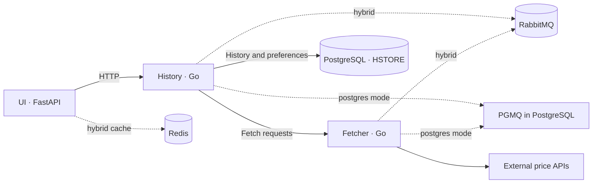

# Data Monitor

A web application for collecting and exploring cryptocurrency price history. Fetcher reads prices from public APIs, History periodically stores them in PostgreSQL, and the web interface displays current values and historical data.

> An educational project with separate services, message queues, Docker Compose for local development, and Vagrant for a multi-VM deployment.

## Features

- Fetch prices from configurable HTTP APIs (BTC and ETH via Coinbase by default).
- Store timestamped price history in PostgreSQL.
- Browse current prices and history in a web interface with charts and user preferences.
- Choose between RabbitMQ + Redis (`hybrid`) or PGMQ + HSTORE in PostgreSQL (`postgres`).
- Run locally with Docker Compose or deploy five VMs with Vagrant.

## Architecture



In `hybrid` mode, RabbitMQ carries requests between History and Fetcher, while Redis caches UI preferences. PostgreSQL stores history and preferences. In `postgres` mode, PGMQ in PostgreSQL provides the queue and HSTORE stores preferences; the applications do not connect to RabbitMQ or Redis.

## Quick start with Docker Compose

You need Docker with Docker Compose and network access to pull images and call the price APIs.

```powershell
cd DataFetcher
Copy-Item .env.example .env
```

Edit `.env`, set your own passwords, and choose `APP_BACKEND=hybrid` or `APP_BACKEND=postgres`. Then start the services:

```sh
docker compose config
docker compose up --build -d
docker compose ps
```

Open the web UI at [http://localhost:8000](http://localhost:8000). Follow service logs with:

```sh
docker compose logs -f ui history fetcher postgres
```

Stop the services while keeping their data with `docker compose down`. The command `docker compose down -v` also deletes the PostgreSQL, Redis, and RabbitMQ volumes.

## Deploy with Vagrant

You need VirtualBox, Vagrant, and a network adapter whose name is set as `BRIDGE` in `Vagrantfile`. Create the local configuration, set your own passwords, and run these commands from the repository root:

```powershell
Copy-Item DataFetcher\env_vagrant_example DataFetcher\.env
vagrant up
```

Vagrant creates five VMs: `postgres` (PostgreSQL, RabbitMQ, and Redis), `fetcher`, `history`, `ui`, and `bastion`. PostgreSQL is available at `192.168.56.13` on the private network. The UI listens on port 8000 on the public network adapter. See the [Vagrant guide](docs/VAGRANT_BROKER_MODE.md) for details.

After changing `.env`, reprovision each service whose container needs the updated environment:

```sh
vagrant provision postgres
vagrant provision fetcher
vagrant provision history
vagrant provision ui
```

## Configuration

| Variable | Purpose |
| --- | --- |
| `APP_BACKEND` | `hybrid` or `postgres`; keep the value consistent across Fetcher, History, and UI |
| `SOURCES` | Comma-separated `name=url` pairs; BTC and ETH are included by default |
| `HISTORY_INTERVAL_SECONDS` | Delay between History requests to Fetcher; the example default is 10 seconds |
| `POSTGRES_*` | PostgreSQL address, database, username, and password |
| `FETCHER_POSTGRES_*` | Credentials for Fetcher's restricted database role |
| `RABBITMQ_URL`, `REDIS_URL` | Connections used in `hybrid` mode |
| `HISTORY_SERVICE_URL` | History service address used by the UI |
| `COOKIE_SECURE` | Set to `true` when the UI uses HTTPS |

Templates: [`.env.example`](DataFetcher/.env.example) for Compose and [`env_vagrant_example`](DataFetcher/env_vagrant_example) for Vagrant. Do not commit `.env` files or private keys.

## HTTP API

| Service | Route | Description |
| --- | --- | --- |
| UI | `GET /` | Web interface |
| UI | `GET /api/sources` | List available sources |
| UI | `GET /api/history?source=btc` | Price history for a source |
| Fetcher | `GET /health` | Fetcher health check |
| Fetcher | `GET /data` or `/data?source=btc` | Latest fetched values |
| History | `GET /health` | History health check |
| History | `GET /history?source=btc&limit=100` | History; `from` and `to` accept RFC 3339 timestamps |
| History | `GET /sources` | Sources stored in the database |

In Compose, Fetcher is published on port 8001, History on 8002, and UI on 8000. For example: `http://localhost:8002/history?source=btc&limit=20`.

## Repository layout

```text
.
├── Vagrantfile
├── provision/                 # VM setup scripts
├── docs/                      # Backend modes and Vagrant guides
└── DataFetcher/
    ├── docker-compose.yml
    ├── fetcher/                # Go: price fetching and request handling
    ├── history/                # Go: collection, PostgreSQL, and API
    ├── ui/                     # FastAPI, templates, CSS, and JavaScript
    └── postgres/               # SQL schema and roles
```

## Troubleshooting

- **Data updates seem infrequent:** check `HISTORY_INTERVAL_SECONDS`. Recreate the Compose container or reprovision `history` in Vagrant after changing it.
- **Services cannot connect after VM startup:** check `vagrant status`, Docker, and logs with `vagrant ssh <vm> -c 'sudo docker logs --tail 100 <container>'`. Make sure all applications use the same `APP_BACKEND` and matching IP addresses.
- **PostgreSQL is not ready:** run `vagrant ssh postgres -c 'sudo docker exec postgres pg_isready -U postgres -d history'` or check `docker compose logs postgres`.
- **Vagrant cannot find the network bridge:** change `BRIDGE` to an adapter name available in VirtualBox.

## Technologies and documentation

Go · FastAPI · PostgreSQL 16 · PGMQ · HSTORE · RabbitMQ · Redis · Docker Compose · Vagrant · VirtualBox

More: [backend modes](docs/BROKER_MODE.md), [Vagrant and mode switching](docs/VAGRANT_BROKER_MODE.md), and the [DataFetcher guide](DataFetcher/README.md).
