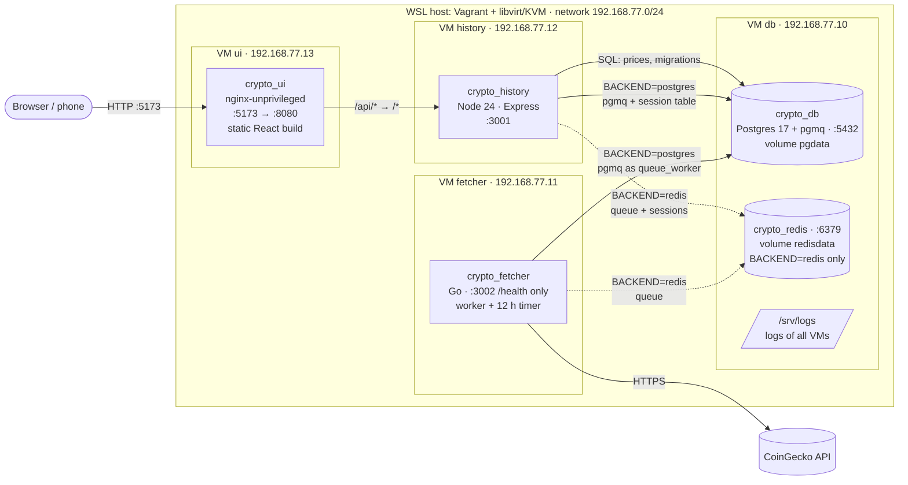
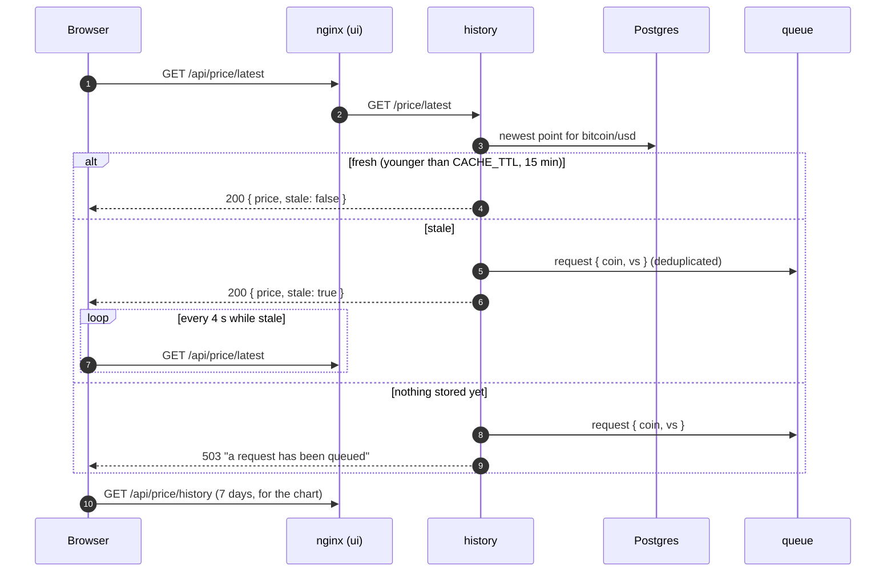
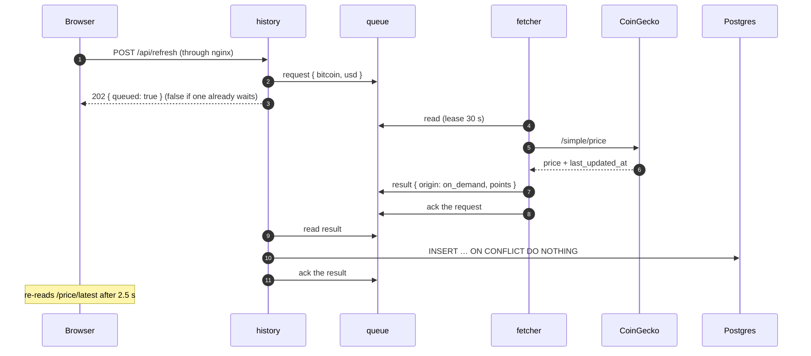
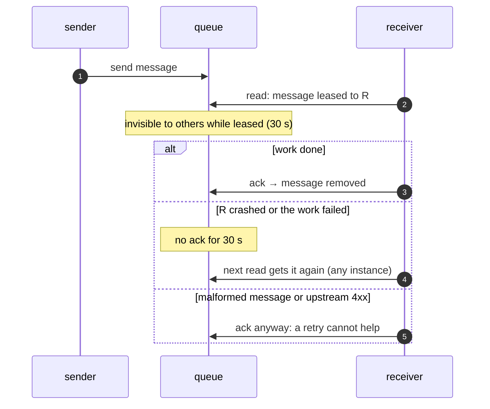
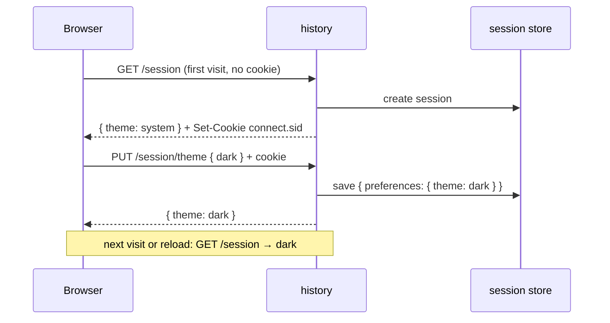
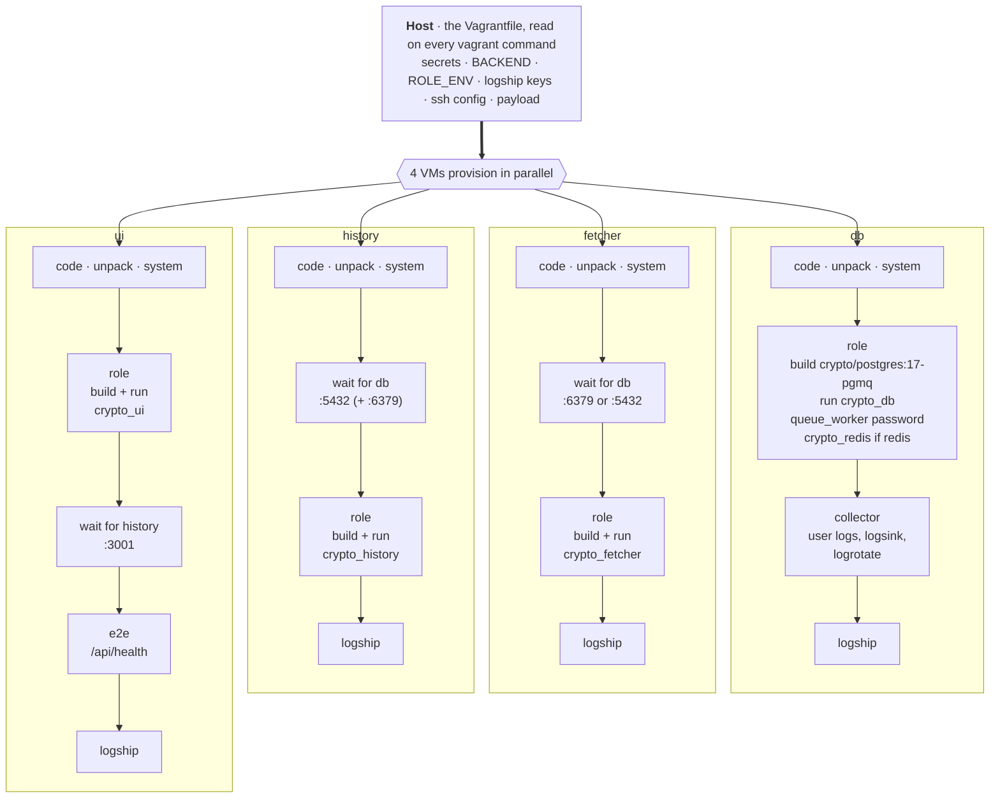
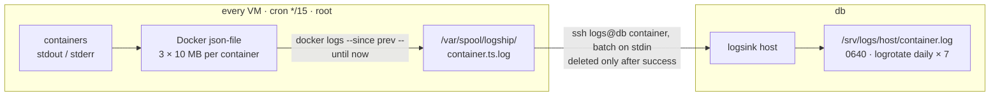

# Architecture

Three services, one Docker container per Vagrant VM, plus a database node.
History and fetcher never call each other: they talk only through a queue,
which lives in Redis or in Postgres depending on `BACKEND`.

## 1. Machines, containers, traffic



- only history writes prices; fetcher's HTTP serves `/health` only;
- Redis, when used, shares the db node: the task forbids separate VMs for infrastructure;
- from Windows and the router's network the VMs are reached through a route to
  `192.168.77.0/24` and `netsh portproxy` (`<laptop>:5173 → ui`); see the README.

## 2. BACKEND: Redis or Postgres for everything

Chosen at provisioning, read by both services at startup. Both implementations are
built in; switching rebuilds nothing.

| | `BACKEND=redis` (default) | `BACKEND=postgres` |
|---|---|---|
| queue | Redis Streams `price:requests`, `price:results` | pgmq queues `price_requests`, `price_results` |
| sessions | Redis keys `session:<id>` | table `session` |
| containers on db | `crypto_db` + `crypto_redis` | `crypto_db` only |
| fetcher connects to | Redis | Postgres as `queue_worker` |

```text
switch:    BACKEND=postgres vagrant provision db fetcher history
remembered in .vagrant/backend; /health of both services shows the active one
```

Each service has one `Queue` interface with two drivers (`history/src/queue/`,
`fetcher/{redisqueue,pgqueue}.go`); the rest of the code does not know which one runs.
Messages are the same JSON in both: requests `{ coin, vs, days? }`, results
`{ coin, vs, origin, points[] }`.

## 3. Request flows

### Opening the page



### Refresh button



Other paths through the same queue:

| path | trigger | request | result origin |
|---|---|---|---|
| bootstrap | history start, empty table | `{ coin, vs, days: 7 }` → `/market_chart` | `bootstrap`, ~169 hourly points |
| timer | fetcher, every 12 h | none, fetcher publishes on its own | `timer` |
| on demand | stale or missing price, Refresh | `{ coin, vs }` → `/simple/price` | `on_demand` |

- no duplicate points: `UNIQUE (coin, vs_currency, observed_at)` + `ON CONFLICT DO NOTHING`;
  `observed_at` comes from CoinGecko, not from our write time;
- only the default pair or one already stored can be fetched; any other `coin`/`vs` → 404,
  so a stray name never costs a CoinGecko call.

## 4. Queue delivery



| | Redis Streams | pgmq (Postgres) |
|---|---|---|
| read | `XREADGROUP BLOCK 5 s` | `pgmq.read_with_poll`, waits 5 s on the server |
| lease | pending entry list | visibility timeout `vt` = 30 s |
| ack | `XACK` | `pgmq.delete` |
| retry | `XAUTOCLAIM` after 30 s idle | `vt` expires, the message is visible again |
| dedup of quote requests | `SET pending:<coin>:<vs> NX EX 30` | unique index on waiting quotes, `23505` = already queued |
| survives a restart | `appendonly yes` | tables in `pgdata` |
| several readers | consumer groups `fetchers`, `history`; consumer = hostname | no groups: any reader takes the next visible message |

- history reads results on a Redis connection of its own: commands on one connection
  run in order, and a blocking read would stall every session lookup behind it;
- `queue_worker` (fetcher's Postgres login, `003_pgmq.sql`): `SELECT, UPDATE, DELETE` on
  requests, `SELECT, INSERT` on results — no prices, no sessions, cannot drop a queue.

## 5. Session (theme)



| | |
|---|---|
| store | Redis `session:<id>` or table `session`, by `BACKEND`; 30 days |
| cookie | `s:<id>.<HMAC>` — identifier only, signed with `SESSION_SECRET`, `HttpOnly`, `SameSite=Lax` |
| scope | session middleware runs after the health and price routes: they create no session |

## 6. Provisioning



Host side, written by the Vagrantfile into `.vagrant/` (git-ignored):

| file | what |
|---|---|
| `secrets.env` | `POSTGRES_PASSWORD`, `REDIS_PASSWORD`, `SESSION_SECRET`, `QUEUE_WORKER_PASSWORD`; 0600, generated once |
| `backend` | the last `BACKEND`, so a later `vagrant provision` keeps it |
| `logship/` | one ssh key per VM + `authorized_keys` for the collector |
| `ssh/config` | `ssh db` and friends from the host |
| `payload.tgz` | the project, ~1 MB, shipped to every VM (no synced folder) |

| step | runs as | does |
|---|---|---|
| code, unpack | root | archive → `/home/vagrant/app`, replaced, not merged |
| system | root | Docker CE + buildx; `json-file` logs capped 3 × 10 MB |
| role | vagrant | writes a 0600 env file with exactly the container's variables → `docker build` → `docker run --env-file` |
| collector | root, db only | user `logs`, `/usr/local/bin/logsink`, `authorized_keys`, logrotate |
| logship | root | key, `/usr/local/bin/logship`, cron every 15 min |

`vagrant/lib.sh`: `env_file` (secrets never on a command line), `replace` (graceful stop,
then run), `wait_healthy`, `wait_port` (up to 5 min). Waiting is required: the
Vagrantfile order is not honoured. Images are built on each VM, no registry, no compose.

**Who gets which variables**

| container | variables |
|---|---|
| `crypto_db` | `POSTGRES_USER`, `POSTGRES_DB`, `POSTGRES_PASSWORD` |
| `crypto_redis` | `REDIS_PASSWORD` |
| `crypto_history` | `BACKEND`, `HISTORY_HOST`, `DATABASE_URL`, `SESSION_SECRET` (+ `REDIS_URL`, `REDIS_PASSWORD`) |
| `crypto_fetcher` | `BACKEND`, `FETCHER_HOST`, then `REDIS_URL` + `REDIS_PASSWORD` **or** `QUEUE_DATABASE_URL` |
| `crypto_ui` | `HISTORY_URL` — no secrets |

## 7. Containers and images

| container | image (build → runtime) | runs with | health |
|---|---|---|---|
| `crypto_ui` | node:24-alpine → nginx-unprivileged:1.29-alpine, ~82 MB | `-p 5173:8080` | `wget /` |
| `crypto_history` | node:24-alpine → distroless/nodejs24:nonroot, ~227 MB | `--read-only --init` | `fetch /health` |
| `crypto_fetcher` | golang:1.27-alpine → distroless/static:nonroot, ~19 MB | `--read-only` | `fetcher healthcheck` |
| `crypto_db` | postgres:17-alpine + pgmq SQL files | volume `pgdata` | `pg_isready -h 127.0.0.1` |
| `crypto_redis` | redis:7-alpine | volume `redisdata`, `appendonly yes` | `redis-cli ping` |

All: `--restart unless-stopped` (back after a reboot), non-root where the image allows,
multi-stage builds with BuildKit cache mounts, `npm ci --omit=dev`,
Go `CGO_ENABLED=0 -trimpath -ldflags="-s -w"`, `.dockerignore` keeps the context small.

History at start: migrations (advisory lock) → results consumer → bootstrap → listen :3001.

## 8. SSH from the host

```text
~/.ssh/config:  Include <project>/.vagrant/ssh/config      (first line)

Host db        HostName 192.168.77.10   IdentityFile .vagrant/machines/db/libvirt/private_key
Host fetcher   HostName 192.168.77.11   …
User vagrant · IdentitiesOnly · no host key check (VMs are recreated)
```

Generated from `MACHINES` on every Vagrant run; keys are the per-machine ones Vagrant
creates on the first `up`.

## 9. Logs



`authorized_keys` of user `logs` on db, one line per VM:

```text
restrict,from="192.168.77.12",command="/usr/local/bin/logsink history" ssh-ed25519 … logship@history

restrict   no shell, PTY, port / agent / X11 forwarding
from=      the key works only from that VM's address
command=   any request runs logsink; the host is fixed by the key,
           the client only names the container: ^[a-z0-9_-]{1,64}$
```

- collector unreachable → batches wait in the spool, the next run sends them;
  if `docker` fails, the window is read again: duplicates beat gaps;
- `flock`: runs never overlap; `docker ps -a`: stopped containers are read too;
- one batch is capped at 50 MB; `authorized_keys` is owned by root;
- retention: db keeps today + 7 rotated days; each VM keeps up to 30 MB per container.

## 10. Known limits

- delivery of logs lags up to 15 min; a dropped connection mid-batch may duplicate part of it;
- switching `BACKEND` does not carry queued messages or sessions over (one request at most,
  the theme resets);
- `StrictHostKeyChecking no` for ssh between VMs and from the host: VMs are recreated;
- no disk quota for `/srv/logs` beyond the per-batch cap;
- one instance of each service: the container hostname is the Redis consumer name.
