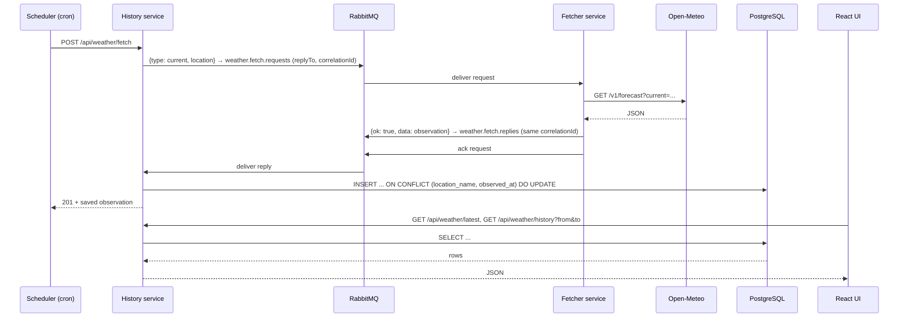

# Architecture

## Components

```
┌────────────┐  POST /api/weather/fetch   ┌────────────────────────┐   weather.fetch.requests   ┌─────────────────┐  HTTPS   ┌────────────┐
│ Scheduler  │ ─────────────────────────▶ │ History service        │ ────────▶ ┌──────────┐ ───▶ │ Fetcher service │ ───────▶ │ Open-Meteo │
│ node-cron  │                            │ (Express, :3001)       │           │ RabbitMQ │      │ (Go, worker)    │          └────────────┘
└────────────┘                            │                        │ ◀──────── └──────────┘ ◀─── └─────────────────┘
┌────────────┐  GET /api/weather/*        │  Sequelize             │   weather.fetch.replies
│ React UI   │ ─────────────────────────▶ └───────────┬────────────┘
│ Vite       │  /api/preferences                      ▼                ┌───────┐
└────────────┘                                 ┌────────────┐          │ Redis │ ◀── History (UI preferences)
                                               │ PostgreSQL │          └───────┘
                                               └────────────┘
```

| Component | Location | Responsibility | Depends on |
|---|---|---|---|
| **Fetcher service** | `fetcher/` | Go worker (compiled binary, no HTTP API). Consumes fetch requests from RabbitMQ, calls Open-Meteo and publishes normalized observations back through a queue. Stateless and has no database. | RabbitMQ, Open-Meteo |
| **History service** | `history/` (port 3001) | HTTP API. Asks the Fetcher for data over RabbitMQ (`history/src/broker/`, `history/src/fetcherClient.js`), stores it through Sequelize, and serves historical data. Keeps UI preferences in Redis (`history/src/cache/`). | RabbitMQ, PostgreSQL, Redis |
| **RabbitMQ** | DB VM / `docker-compose.yml` | Two durable queues: `weather.fetch.requests` and `weather.fetch.replies`. | — |
| **Scheduler** | `scheduler/` | Separate process that calls `POST /api/weather/fetch` on a cron schedule (hourly by default). | History service URL only |
| **Frontend** | `frontend/` | React UI: latest reading, range selector, charts and table. | History service API |
| **Database** | `docker-compose.yml` | Generic PostgreSQL 16 container. The app uses its own database (`weather`) inside it and creates that database if it's missing. | — |

This is the default (`USE_REDIS_RABBITMQ=true`); with `false` PostgreSQL also takes over the queues and the cache,
see [Backends](#backends).

Each component knows only the component next to it. The scheduler doesn't know about the weather API. The Fetcher
doesn't know about the database or the History service: it only sees the queues. There is no direct HTTP between the
History service and the Fetcher. The frontend only talks to the History service.

## Request flow



## Startup catch-up

On start the History service (in the background, with retries) looks up the newest stored `observedAt`, asks the
Fetcher (a `history` request with `days=N`) for the gap (N = gap in days rounded up, at most 92; 30 if the table is empty)
and inserts the rows with `ON CONFLICT DO NOTHING`. The Fetcher stays stateless and does not know about the gap.

## Fetcher messages (RabbitMQ)

The Fetcher is stateless: the caller (the History service) sends the location with every request. Request/reply over
two durable queues in the `weather` vhost:

- the History service publishes a request to `weather.fetch.requests` with `replyTo = weather.fetch.replies`, a fresh
  `correlationId` and `expiration` = its 20 s timeout (a request nobody waits for any more expires in the queue);
- the Fetcher consumes it (prefetch 4), calls Open-Meteo, publishes the reply to `replyTo` with the same
  `correlationId`, and only then acks the request (a crash in between makes RabbitMQ redeliver it);
- the History service matches the reply to the waiting call by `correlationId`; replies nobody waits for are logged and dropped.

| Request | Reply `data` |
|---|---|
| `{ "type": "current", "location": { "name", "latitude", "longitude" } }` | one observation |
| `{ "type": "history", "location": {...}, "days": 1..92 }` (default 7) | hourly observations for the last `days` days, up to now |

Errors look like `{ "ok": false, "error": "message", "kind": "bad_request" | "upstream" | "internal" }`;
success is `{ "ok": true, "data": ... }`.

An observation is a plain object:
`{ locationName, latitude, longitude, observedAt, temperature, apparentTemperature, humidity, precipitation, windSpeed, windDirection, weatherCode, source }`.

Inside the History service, `history/src/fetcherClient.js` wraps these calls as `fetchCurrent(location)` and
`fetchRecentHistory(location, days)`. It turns `observedAt` back into a `Date` and throws `FetcherError` if the broker
is down, no reply arrives in time, or the Fetcher replies with an error (the History service then answers with 502).

The Fetcher does not reconnect by itself: when the connection to RabbitMQ is lost it exits with an error and Docker
restarts the container (`--restart unless-stopped`). The History service reconnects in the background, with backoff.

To run the Fetcher without the server or database: `cd fetcher && go run ./cmd/fetcher --once` (add `--history 2` for hourly data).

## Backends

`USE_REDIS_RABBITMQ` (History and Fetcher, default `true`; `1/0`, `yes/no` work too, anything else stops the start
with an error) picks where the cache and the queues live. Both clients are always built in; only the chosen module
is loaded (`history/src/broker/index.js`, `history/src/cache/index.js`, `fetcher/cmd/fetcher/main.go`).

| | `true` | `false` |
|---|---|---|
| Queues History ↔ Fetcher | RabbitMQ, `weather.fetch.requests` / `.replies` | pgmq, `weather_fetch_requests` / `_replies` (tables `pgmq.q_*` in the app database) |
| Cache (UI preferences) | Redis, `SET key <json> EX ttl` | `cache_entries`, an UNLOGGED table, cleaned by pg_cron |
| Fetcher needs | `AMQP_URL` | `DATABASE_URL` (on Vagrant the role `fetcher`, which may only touch the two queue tables) |
| History needs | `DATABASE_URL`, `AMQP_URL`, `REDIS_URL` | `DATABASE_URL` only |
| PostgreSQL | plain `postgres:16-alpine`, no extensions | `weather/postgres` with pgmq and pg_cron |
| Redis, RabbitMQ containers | running | not started |

The messages are the same JSON in both cases (see [Fetcher messages](#fetcher-messages-rabbitmq)), and
`fetcherClient.js`, the Fetcher's `Handle()` and the HTTP API do not know which backend is used. `/api/health`
names it in `backend` (`redis-rabbitmq` or `postgres`).

### Queues in pgmq

[pgmq](https://github.com/pgmq/pgmq) is a PostgreSQL extension (plain SQL) with SQS-like queues: `send` inserts a
row, `read` hides it for a visibility timeout (vt) instead of locking it, `delete` removes it.

- The History service sends the request as the message and puts what AMQP keeps in message properties into the
  pgmq `headers`: `{correlationId, replyTo: "weather_fetch_replies", expiresAt}`. pgmq has no per-message TTL, so
  `expiresAt` (now + the 20 s timeout) replaces the AMQP `expiration`.
- The Fetcher long-polls with `pgmq.read_with_poll(queue, vt 30 s, up to 4 free slots, 5 s, every 250 ms)`, at most
  4 requests at a time (the AMQP prefetch). It drops a request that has no `replyTo` or whose `expiresAt` has
  passed, without calling Open-Meteo. Otherwise it sends the reply (headers `{correlationId}`) and deletes the
  request **in one transaction**. If the Fetcher dies before the commit, the request becomes visible again after
  30 s and is handled again, like an unacked AMQP message.
- The History service reads replies on one dedicated connection (`read_with_poll`, up to 50 at a time), settles
  the waiting calls by `correlationId` and deletes the replies. The extension and both queues are created on
  start if missing (`pgmq.create` is idempotent), like `assertQueue`; on Vagrant `db.sh` also creates them, so the
  Fetcher can start before History.
- Like with RabbitMQ, the Fetcher exits when a database call fails (Docker restarts it) and History reconnects
  with backoff.

### Cache in PostgreSQL

```sql
CREATE UNLOGGED TABLE cache_entries (key text PRIMARY KEY, value jsonb NOT NULL, expires_at timestamptz);
```

The same keys and JSON values as in Redis (`preferences:<uid>` → `{"theme":"dark"}`), with the TTL as `expires_at`.

- **UNLOGGED**: no WAL, so a write costs no WAL flush; the table is emptied after a crash (not after a clean
  restart), which is what a cache may do. A small hot table is served from `shared_buffers` (RAM) either way; Redis
  is still faster per operation, but every call crosses the network between the VMs, so for UI preferences the
  difference does not show.
- **TTL**: a read ignores expired rows; the pg_cron job `weather-cache-ttl` deletes them every minute
  (`DELETE FROM cache_entries WHERE expires_at < now()`). History creates the table, the extension and the job on
  start (`cron.schedule` with the same name updates the job). pg_cron needs `shared_preload_libraries=pg_cron` and
  runs jobs only in `cron.database_name`, so that must be the app database; it connects for each run over
  `cron.host` (here the Unix socket, see [infrastructure.md#postgresql](infrastructure.md#postgresql)).

## Data model

Table `weather_observations` (created by `sequelize.sync()` at startup):

| Column | Type | Notes |
|---|---|---|
| id | serial PK | |
| location_name, latitude, longitude | text / double | |
| observed_at | timestamptz | time the data applies to (UTC) |
| temperature, apparent_temperature | real | °C |
| humidity | real | % |
| precipitation | real | mm |
| wind_speed | real | km/h |
| wind_direction | real | degrees |
| weather_code | integer | WMO code; the API also returns `conditions` text |
| source | enum `current` / `historical` | scheduled fetch or backfill |
| created_at, updated_at | timestamptz | |

A unique index on `(location_name, observed_at)` makes writes idempotent:

- **fetch** stores the current reading under the start of its hour (10:45 → 10:00) and does an upsert, so repeating
  a fetch in the same hour refreshes that hour's row instead of adding a new one;
- **backfill** inserts only missing hours and never overwrites rows that already exist.

So there is one row per hour, whether it came from a fetch or a backfill. Rows from older versions with
quarter-hour times (`:15`, `:30`, `:45`) can be removed with
`DELETE FROM weather_observations WHERE date_trunc('hour', observed_at) <> observed_at;`

## HTTP API

| Method | Path | Description |
|---|---|---|
| GET | `/api/health` | `{ status, database, cache, broker, backend }` |
| GET / PUT | `/api/preferences` | UI preferences of this browser (`{ theme }`), stored in the cache (Redis or `cache_entries`); the browser is identified by the `uid` cookie. |
| POST | `/api/weather/fetch` | Fetch current weather and store it. Returns the stored observation (201). |
| POST | `/api/weather/backfill` | Body `{ "days": 1..92 }` (default 7). Returns `{ days, fetched, inserted }`. |
| GET | `/api/weather/latest` | Latest observation, or 404 if there are none yet. |
| GET | `/api/weather/history?from=&to=&limit=` | Observations in the range, oldest first. `from`/`to` are ISO dates and default to the last 7 days. `limit` is capped at 5000. |

If `TRIGGER_TOKEN` is set in `history/.env`, both POST endpoints require an `X-Trigger-Token` header with that value.
Errors look like `{ "error": "message" }`: 400 for invalid input, 502 if the Fetcher service or the weather API fails, 500 for anything else.

## Deliberate simplifications (demo scope)

- The table is created with `sequelize.sync()`. There's no migration tooling.
- The app tracks a single location, set in `history/.env`. The schema already stores the location, so adding more would be simple.
- There's no authentication beyond the optional trigger token.
- For local development PostgreSQL and RabbitMQ run in Docker; the services run locally.
- The Fetcher has no network API at all; only clients with RabbitMQ (or queue database) credentials can send it requests.
- Switching the backend does not move data: requests in the old queues are dropped and saved themes start empty.
